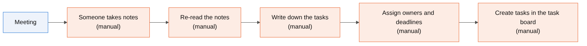
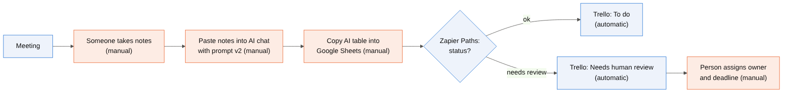
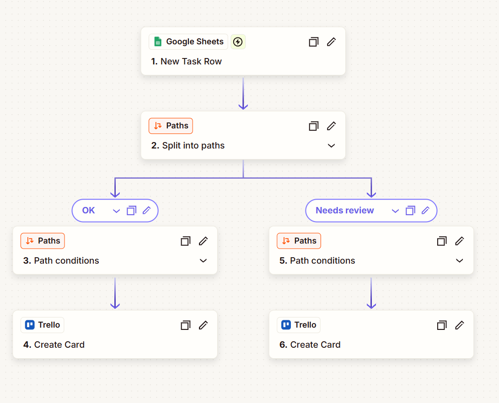
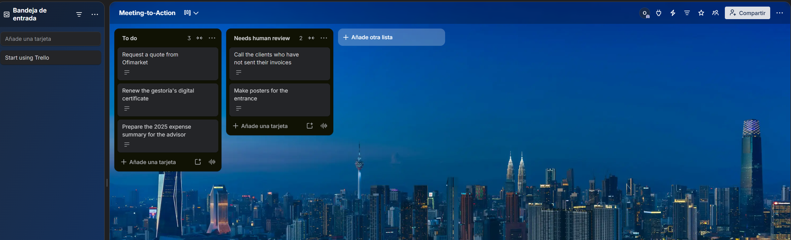

# Meeting-to-Action: from meeting notes to tasks with AI and Zapier

A workflow that turns meeting notes into tasks in Trello. If the owner or the deadline of a task is not clear, the task goes to a separate list for human review.

Self-directed prototype. Synthetic data.

**Demo video (Loom):** [Watch the 4-minute demo](https://www.loom.com/share/60964a50c0ad41a8b04c5766875d2720)

## Problem

After a meeting, someone must read the notes, find the tasks, assign owners and deadlines, and create the tasks in a task board. This is slow. Tasks without a clear owner or deadline often get lost.

## Solution

1. An AI assistant reads the meeting notes with a fixed prompt and returns a table: task, owner, deadline, status, quote.
2. If the owner or the deadline is not clear, the status is "needs review".
3. The table goes into Google Sheets.
4. A Zapier workflow reads each new row and creates a Trello card:
   - status "ok" → list **To do**
   - status "needs review" → list **Needs human review**
5. A person checks the unclear tasks and assigns an owner and a deadline.

## Tools

Claude Opus 5.5 (claude.ai chat, medium setting), Google Sheets, Zapier (Paths), Trello.

## How it works

Before: 5 manual steps.

After: the cards are created and sorted automatically. A person only reviews the unclear tasks.

The Zap: a new row in Google Sheets → Paths by status → Trello card in the right list.

Result in Trello after a test with 5 rows (3 "ok", 2 "needs review"). All 5 cards went to the correct list.

## Results: prompt accuracy

I wrote 12 synthetic meetings (in Spanish) and made a ground truth list by hand: 41 tasks. Then I ran two prompt versions on the same 12 meetings, in a new chat for every meeting, and compared each AI row with the ground truth.

| Metric | Prompt v1 | Prompt v2 |
| --- | --- | --- |
| Rows returned by AI | 48 | 41 |
| Correct | 37 | 39 |
| Missed | 0 | 2 |
| Extra rows (not real tasks) | 7 | 0 |
| **Recall** (correct ÷ ground truth) | **90%** | **95%** |
| **Precision** (correct ÷ all AI rows) | **77%** | **95%** |
| Unclear tasks sent to "needs review" | 9 of 9 | 7 of 9 |

**Prompt v2 raised precision from 77% to 95% on 12 synthetic meetings, but dropped 2 of 9 unclear tasks instead of sending them to human review.**

### What went wrong in v1

- Postponed items were listed as tasks ("we will discuss it in April").
- Background information was listed as a task (the reason for a request, not the action).
- One task was split into two rows.
- Vague deadlines ("soon", "as soon as possible") were marked "unclear". In my ground truth they count as deadlines.

### What changed in v2

New rules: postponed or undecided items are not tasks; one commitment = one row; vague time words count as a deadline; output only the table. See [prompts/extract-v2.md](prompts/extract-v2.md).

### The trade-off

The rule "postponed items are not tasks" was too strong. In two meetings the AI read "when there is time" and "we will see the date later" as postponed, and dropped the tasks. These were exactly the unclear tasks that should go to a person. An extra card is easy to delete. A missing card is never seen. **Better numbers are not always better for the business.**

## Limitations

- Small sample: 12 synthetic meetings, 41 tasks, one person made the ground truth.
- Prompt v2 rules were written after looking at v1 errors on the same 12 meetings. On new meetings the results may be lower.
- One model only (Claude Opus 5.5, medium). Results can change with another model or version.
- The AI step is manual: I paste the notes into a chat and copy the table into Google Sheets. There is no API connection.
- I did not measure the time saved.
- Zapier: when I pasted several rows at once, sometimes only one card was created, and sometimes cards appeared with a delay of several minutes. Adding rows one by one worked better.
- Paths in Zapier is a paid feature. I used the free trial.

## Files

- `prompts/` - prompt v1 and v2
- `data/meetings/` - 12 synthetic meeting notes (Spanish)
- `data/ground_truth.csv` - the correct tasks, made by hand
- `data/results-v1.csv`, `data/results-v2.csv` - AI output with my check for every row
- `images/` - diagrams and screenshots

## About

Olga Sorokina - AI automation for accounting and office workflows. Málaga, Spain.
